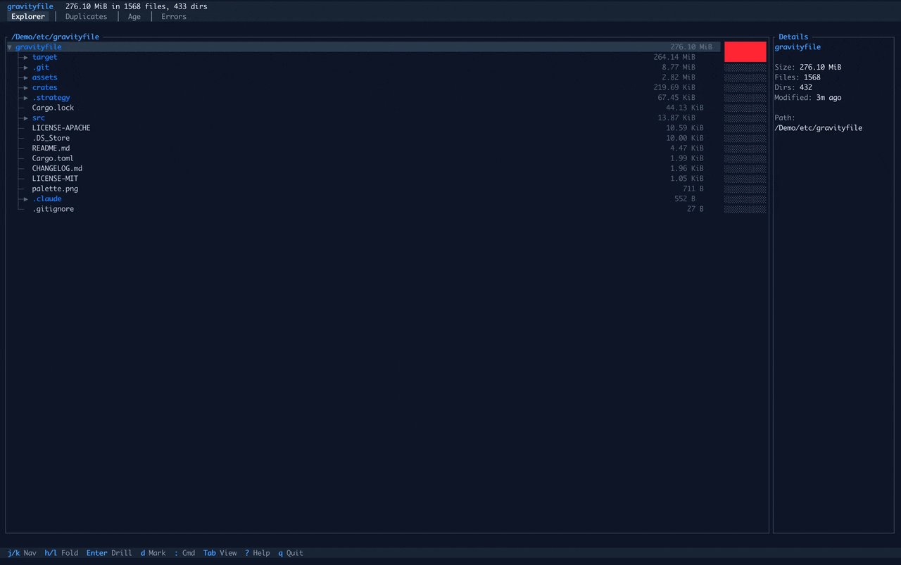

# gravityfile

[](#license)
[](https://crates.io/crates/gravityfile)

See where your disk space went, then do something about it. `grav` is a fast
disk usage analyzer and a keyboard-driven file explorer in one terminal app,
with a scriptable CLI for reports.



- **Fast, exact scanning.** A parallel scanner whose totals match `du`: disk
  usage by default, hard links counted once, directories including their own
  blocks. Comparable to `dust` in speed and memory on large trees.
- **Three views of the same tree:** an expandable tree, Miller columns, and a
  treemap, plus duplicate-file and file-age views.
- **A real file manager:** copy, move, rename (including bulk rename in your
  editor), archives, and delete to the system Trash. Moves, copies, renames and
  new files can be undone, as can deletions on Linux and Windows. Overwritten
  files go to the Trash rather than being destroyed.
- **Previews** with syntax highlighting, hex view, archive listings and images.
- **Git status** for every file.
- **Reports for scripts:** `scan`, `duplicates`, `age` and `export` emit
  versioned JSON with explicit completeness and meaningful exit codes.
- **Lua plugins**, each in its own supervised process.

## Install

```sh
cargo install --locked gravityfile
```

This installs the `grav` binary. Building from a checkout needs Rust 1.90 or
newer: `cargo install --locked --path .`.

## Use

```sh
grav                     # explore the current directory
grav ~/Downloads --scan  # explore and start a full scan right away
grav scan ~              # largest entries in your home directory
grav scan / -d 2 -n 10   # two levels deep, ten entries per directory
grav duplicates ~/Photos --min-size 1MB
grav age ~/work --stale 6mo
```

Sizes use decimal units (`1 kB = 1000 B`, like Finder); add `--binary` for
`KiB`, `MiB`. Every command accepts the same scan options:

| Option | Effect |
|---|---|
| `-A`, `--apparent-size` | Count file lengths instead of disk usage |
| `-l`, `--count-links` | Count every hard link to a file |
| `-L`, `--follow-symlinks` | Follow symbolic links |
| `--cross-fs` | Descend into other filesystems |
| `--no-hidden` | Skip dotfiles |
| `-e`, `--exclude GLOB` | Skip matching names or paths (repeatable) |
| `-j`, `--threads N` | Scanning threads |
| `--git` | Annotate entries with Git status |

### Shell integration

`grav init` prints a `grav` shell function that changes your shell to the
directory you were in when you quit the explorer:

```sh
eval "$(command grav init zsh)"     # ~/.zshrc
eval "$(command grav init bash)"    # ~/.bashrc
command grav init fish | source     # ~/.config/fish/config.fish
```

Completions: `grav completions <bash|zsh|fish|elvish|powershell>`.

### Explorer keys

| Key | Action |
| --- | --- |
| `j` / `k` | Move down / up |
| `h` / `l` | Collapse / expand |
| `Enter` / `Backspace` | Enter directory / go back |
| `v` | Cycle tree, Miller and treemap layouts |
| `Tab` | Switch explorer, duplicates, age and errors views |
| `Space` / `V` | Mark item / range selection |
| `y` / `x` / `p` | Copy / cut / paste |
| `d` / `D` | Delete through Trash |
| `Ctrl-z` | Undo |
| `/` / `:` | Search / command palette |
| `P` | Cycle preview mode |
| `?` / `q` | Help / quit |

Bulk rename and the text editor use `VISUAL` or `EDITOR`; GUI editors must wait
for the file to close (for example `code --wait`).

### Snapshots

Save a scan and look at it later, or somewhere else. Any command that takes a
directory also takes a snapshot, and ncdu dumps work too:

```sh
grav export / -o root.json.zst          # complete scan, zstd-compressed
grav scan root.json.zst -d 3            # browse it without rescanning
grav scan root.json.zst -A              # switch to apparent sizes, instantly
ssh server 'ncdu -xo- /' > server.json  # a dump from a machine without grav
grav scan server.json
grav export ~ -f ncdu -o home.json      # for ncdu -f or gdu -f
```

## Reports and automation

```sh
grav scan . -f json | jq '.data.entries[0]'
grav duplicates /data -f json --strict > duplicates.json
```

JSON output always carries a `schema_version`, the scan scope, and a `status`
saying whether anything could not be read. With `--strict`, incomplete results
exit with status 3. See [reports](docs/REPORTS.md) for the format, exit codes,
and how unusual file names are encoded.

## Plugins

Lua plugins can react to scans, navigation and file operations, and veto
actions. Each runs in its own worker process with deadlines and bounded
messages; a stuck or crashed plugin is killed without affecting the explorer.
Plugins are not sandboxed from the filesystem or network. See
[plugins](docs/PLUGINS.md).

## Development

```sh
just test    # cargo nextest across the workspace
just ci      # lint, tests, docs, MSRV, cargo-deny, terminal smoke test
```

[Architecture](docs/ARCHITECTURE.md) describes the crates.

## License

Licensed under either [Apache-2.0](LICENSE-APACHE) or [MIT](LICENSE-MIT), at your option.
